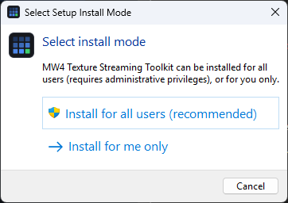
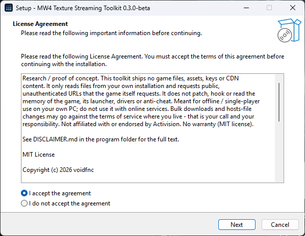
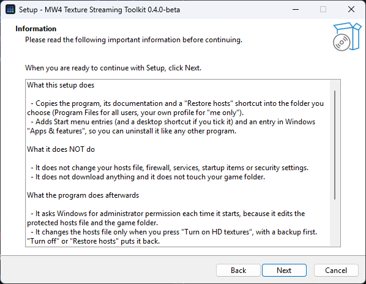
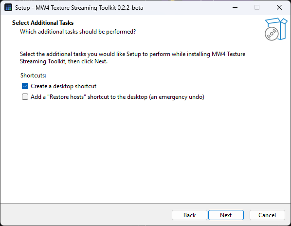
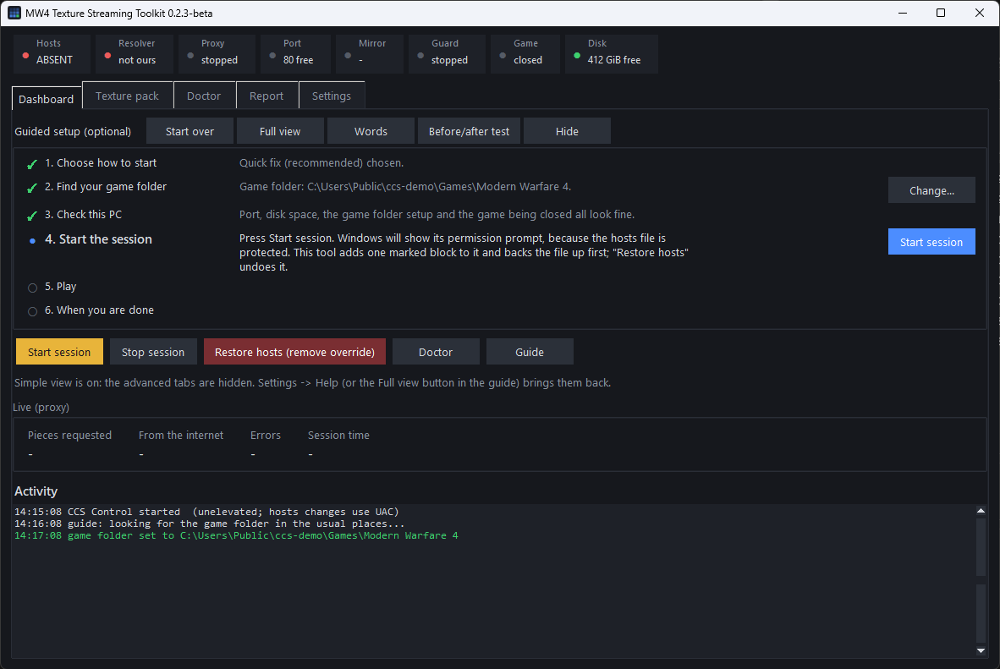
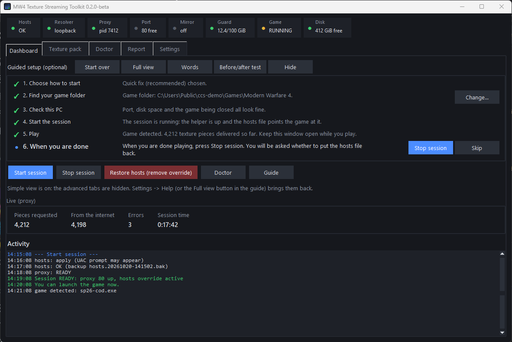
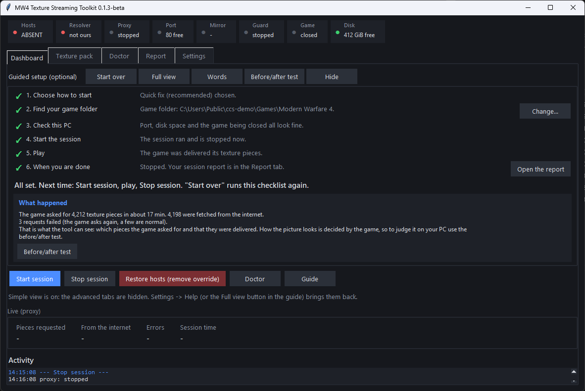
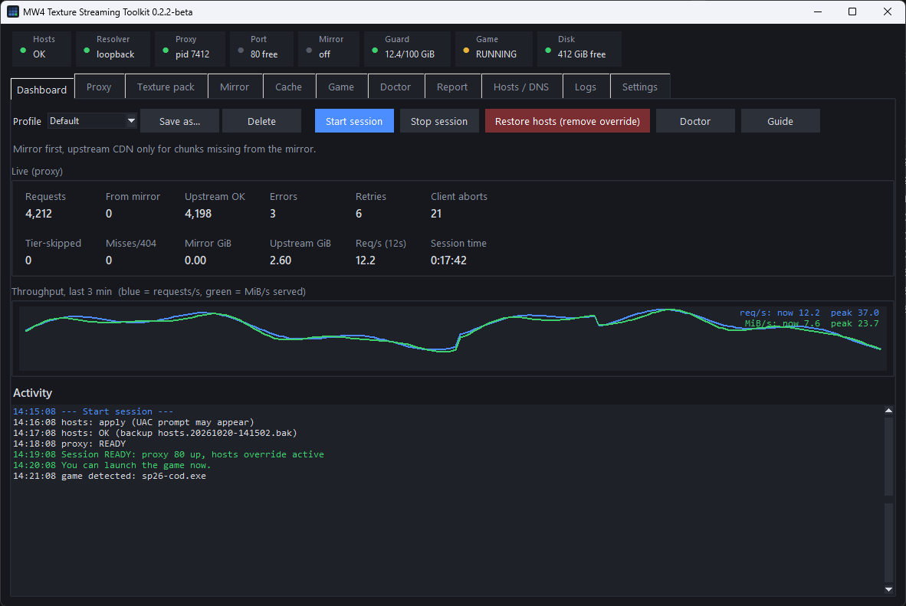
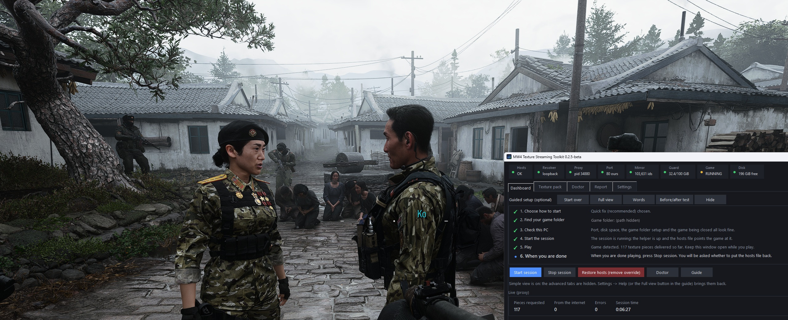
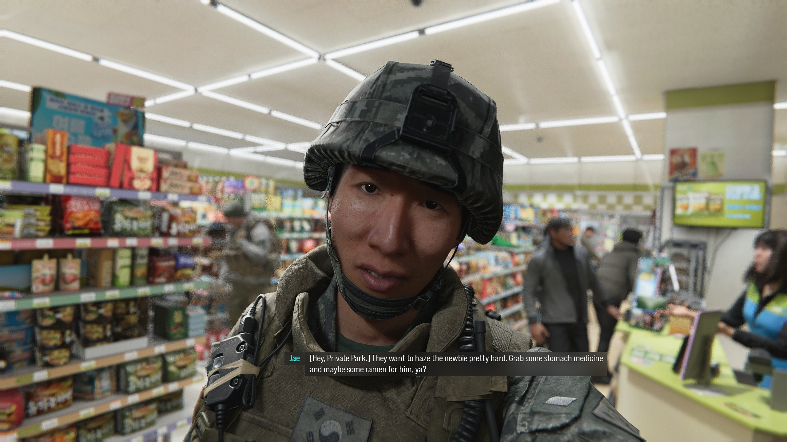

# MW4 Texture Streaming Toolkit

Beta 0.2.6 · Windows · installer or portable zip (no Python needed) · from source: Python 3.10+, standard library only

I started this because the Modern Warfare campaign on my PC looked blurry no matter what I did in the graphics menu. Walls and character gear sat on the lowest
texture tier even with every setting maxed out. The game is supposed to download higher-resolution texture pieces from a CDN while you play, and on my machine
it never did. This repository is what came out of tracking that down: a short explanation of the bug, and a set of small tools that work around it.

> **Please read this first.** This is research / proof-of-concept code. The repository contains **source code and written notes only**: no Activision files, game
> assets, game binaries, CDN content, keys or chunk catalogues, and none will ever be shared here. Please don't attach any to issues or pull requests.
> The tools only read files from your own installation and only request public, unauthenticated URLs that the game itself requests. They don't patch, hook or read
> the memory of the game, its launcher, drivers or anti-cheat, and they don't get around any licensing, DRM or login. I wrote them for offline, single-player use on
> my own computer.
> Using them is your decision and your responsibility. Downloading game content in bulk, editing your hosts file and routing the game through a local proxy may go
> against the game's terms of service, or the law where you live. This project is not affiliated with or endorsed by Activision. "Call of Duty" and "Modern
> Warfare" are trademarks of their owners and appear here only to say what the tools are for. No warranty (see [LICENSE](LICENSE) and [DISCLAIMER.md](DISCLAIMER.md)).

## What was wrong

On a PC whose internet connection has no IPv6, the game's texture streamer looks up the CDN host name (`cod-assets.cdn.callofduty.com`) and only accepts an IPv6
answer. Windows hands it an IPv4 address wrapped as IPv6 (`::ffff:a.b.c.d`), and then refuses to open a socket to that address, so the game never sends a single
packet. Nothing in the UI tells you. The cache folder just stays empty and you play on the shipped low-resolution textures.

Pointing the CDN host name at the loopback address in the hosts file and running a small local proxy that forwards the requests over IPv4 is enough to make the
unmodified game start streaming. The whole story, with the captures that show it, is in [docs/ISSUE-ipv6-cdn-lookup.md](docs/ISSUE-ipv6-cdn-lookup.md) and
[docs/FINDINGS.md](docs/FINDINGS.md).

## What the toolkit does

- **Hosts manager** (`tools/ccshosts.py`): adds and removes the override in a clearly marked block, makes a backup before every change, reads the file back to check
  it, and rolls back if something is off. It needs administrator rights, which the program has (see [Administrator rights](#administrator-rights)).
- **Proxy** (`tools/ccsproxy.py`): listens on loopback, forwards chunk requests to the CDN, or serves them from a local mirror. It can also refuse chunks above a size
  you choose.
- **Mirror** (`tools/ccsmirror.py`): downloads the chunks once, checks each one (size and MD5 against the server's ETag), and can be paused and resumed. You can
  limit bandwidth, set a daily quota, pick a detail level, and it waits patiently if your connection drops. Defaults are deliberately gentle (4 connections, 50
  requests per second, a User-Agent that names the tool, back-off on HTTP 429/503).
- **Control window** (`tools/ccsgui.py`; in the installer and the zip it is `MW4 Texture Streaming.exe`): one place for all of the above, plus a doctor that checks your setup, live
  statistics, and a report for every game session (what the game asked for, how fast, how much was already in its cache).
- **Guided setup and Simple view**: an optional checklist that finds your game folder, checks the PC and ticks each step off, with hover help, plain-language help cards
  for the usual failures and a before/after test. New here? See [docs/GETTING-STARTED.md](docs/GETTING-STARTED.md).
- **Texture pack tab**: choose what to mirror (campaign only, everything, or specific packages) and how large chunks may be. See
  [docs/TEXTURE-PACK.md](docs/TEXTURE-PACK.md).

The proxy and mirror never touch the game process. Details of how the pieces fit together are in [docs/ARCHITECTURE.md](docs/ARCHITECTURE.md).

## Download

Pick one. The files are on the [Releases page](https://github.com/voidfnc/mw4-texture-streaming-research/releases) (while the versions are betas they are marked *Pre-release*).

| | What you get | Who it is for |
|---|---|---|
| **Installer** (recommended) | `MW4-Texture-Streaming-<version>-Setup.exe`. Double-click, Next, Install. Installs for all users by default (Program Files, one Windows permission prompt); "for me only" (no administrator rights, in your own profile) is an option on the first screen. The program itself also asks for administrator permission when it starts. Start menu entries, optional desktop shortcut, uninstall in *Apps & features*. | Most people. Needs no Python. |
| **Portable zip** | `MW4-Texture-Streaming-<version>-win64-portable.zip`. Unzip anywhere and run `MW4 Texture Streaming.exe`. Nothing is installed; settings stay in a `data` folder next to it; delete the folder to remove it. | Locked-down PCs, a USB stick, trying it out. |
| **From source** | Clone this repository and run `python tools\ccsgui.py` (Python 3.10+, standard library only). See [Running from source](#running-from-source). | Developers and advanced users. Everything is in this repository. |

Windows may say "Windows protected your PC" (SmartScreen) because the files are not code-signed yet: choose *More info*, then *Run anyway*. You can check a download against
`SHA256SUMS.txt` on the release page (`certutil -hashfile <file> SHA256`). Release files are built from the tagged source with `packaging\build.bat` (see CONTRIBUTING). The installer changes nothing in your hosts file; the program does that only when you press *Start session*.

## What it looks like

**The installer** asks whether to install for all users (the default: Program Files, one permission prompt) or for you only (no administrator rights), shows the notice and licence, says what it will and will not do, and
offers the shortcuts. Cancelling at any point installs nothing.






**The program.** Screenshots of version **0.2.3-beta** on Windows 11. They show demo numbers from a throw-away folder: no game was running, and there is no game imagery in them (the two in-game frames are further down). They are
regenerated when the windows change (`python tools\make_screenshots.py`; the installer pages with `python packaging\shoot_installer.py`); the version in the title bar is the version they were taken with. Later versions start with an administrator prompt, so the first line of the activity log reads slightly differently there. The four installer pages above are from 0.2.5-beta.

**Guided setup in Simple view**: the checklist ticks the steps it can verify and highlights the next button (here *Start session*).



**During a session**: the live counters and the Activity log, with the checklist waiting for you to finish playing.



**After the session**: a short "What happened" summary of what the game asked for and what was delivered. It says nothing about how the picture looks; the before/after test is for that.



**Full view**: every tab, all twelve counters and the throughput graph, for when you want the detail.



**In the game.** Two frames from a play session of the single-player campaign at 2560x1440 with the toolkit running (0.2.5-beta). In the first, the Dashboard sits next to the game: 117
texture pieces delivered so far, none from the internet, no errors (the game folder path in the window is covered). In the second, a close-up of a character and a shop interior. They show how
the game looks with the streamed textures; they are not a measured comparison (I took no before/after pairs, see [section 7 of FINDINGS](docs/FINDINGS.md#7-what-i-could-not-verify)).
The frames are copyrighted game art, shown here only to illustrate the toolkit.




## Video walkthrough

A narrated walkthrough of the problem, the fix and the program, about four minutes: [MW4-Texture-Streaming-Walkthrough.mp4](https://github.com/voidfnc/mw4-texture-streaming-research/releases/download/v0.2.6-beta/MW4-Texture-Streaming-Walkthrough.mp4)
(about 59 MB, attached to the 0.2.6-beta release). It is made of the screenshots on this page, a few animated diagrams and the two in-game frames above, with captions; the narration is a synthetic (text-to-speech)
voice, and the music and sound effects are generated, not recorded. The same notes apply: the program windows are version 0.2.3-beta, the installer pages 0.2.5-beta, the in-game frames are not a
measured comparison, and the game art belongs to its owners.

## Running from source

You need a PC install of the game, Python 3.10 or newer with tkinter (the normal python.org installer has it), and a few GiB of free disk space at the very least.
The full campaign set is around 82 GiB; a smaller "standard" level is about 54 GiB.

```
git clone https://github.com/voidfnc/mw4-texture-streaming-research
cd mw4-texture-streaming-research
python tools\ccsgui.py
```

On first start the window offers a short guided setup: a checklist on the Dashboard that finds your game folder (you confirm what it finds), checks the PC, and ticks
each step off by itself. It is optional and never changes anything without a click; the *Guide* button turns it on or off. New to all this? Start with
[docs/GETTING-STARTED.md](docs/GETTING-STARTED.md): plain words, no command line, a list of what the terms mean. Nothing is assumed, and the settings live in
`tools\work\gui_settings.json`. Then use *Start session*, launch the game, and watch the Dashboard. [docs/USAGE.md](docs/USAGE.md) walks through each tab, and the command-line versions of everything are listed there too.
To undo the hosts change at any time run `tools\restore-hosts.bat`.

The tests don't need the game: `python -m unittest discover -s tools/tests` (196 tests, a couple of minutes).

## Administrator rights

The program asks for administrator permission when it starts (the Windows prompt, called UAC) and runs with it. It needs it for three things: the hosts file is protected, the
game folder is often inside Program Files, where a normal user cannot write to a texture mirror or change the game's settings files, and the one-time *Game setup* changes
files in the game folder. With the rights from the start, none of these asks again. It uses them only for what this README lists: the marked block in the hosts file, the
game setup you confirm, and its own files. If you decline the prompt the program still starts and asks for permission for each hosts-file change, as before. From source, the
window relaunches itself elevated once (`CCS_NO_ELEVATE=1` or `--no-elevate` keeps it unelevated). The setup program itself runs without administrator rights.

Because the program runs elevated, whoever can change its files can make it run their code with those rights. That is why the installer's default is to install for all users (Program Files):
only an administrator can change files there. If you choose "for me only", the files are inside your own profile and other programs that run as you could replace them; the portable zip
has the same property, so keep it in a folder only you can write to.

## If something doesn't work

Most problems show up in the *Doctor* tab, which tells you what is wrong and offers a fix. Problems that have come up:

**"Permission denied" when the hosts file is written.** Windows protects that file on purpose, and a write can be refused even when the window says it runs as
administrator. The usual causes are the read-only attribute on the file (run `attrib -r "%SystemRoot%\System32\drivers\etc\hosts"` in an admin Command Prompt) or
security software with hosts-file protection (pause it briefly or allow `MW4 Texture Streaming.exe` and `ccs-cli.exe`, or `python.exe` when running from source, apply the override, turn it back on). A refused write leaves the file
untouched, and the message says so. I don't turn off anyone's security software and I don't change permissions on system files for you; that is your call. If you
would rather not let the tool write the file at all, you can add the two lines yourself (`ccs-cli.exe --ccs-run ccshosts diff apply`, or `python tools\ccshosts.py diff apply` from source, shows them).

**Textures are streamed (the report shows requests and answers) but still look low.** In some game folders the Steam settings put the game in offline mode, and the game can look for its
cache in `sp26\xpak_cache` while the engine fills `xpak_cache`. The Doctor's *Game setup* row (and the guide's *Check this PC* step) fixes both after you confirm: it sets
`offline=0` and `disable_lan_only=1` in `sp26\steam_settings\configs.main.ini` (a copy of the original is kept) and links `sp26\xpak_cache` to `xpak_cache`. Close the game first,
and start it again afterwards. Details and the command line: [docs/USAGE.md](docs/USAGE.md#game-setup-online-mode-and-the-cache-link).

**I built an offline copy. Can I play without the program?** No. The game still asks for its textures through the helper, so each time you play: start the program, press *Start session*, launch the game and
keep the window open. The copy only means the pieces come from your disk instead of the internet; the game does not read it on its own. The copy is kept in the mirror folder (the Texture pack tab shows where; by default a
`mirror` folder inside the game folder). With the Default profile it is used first, and *Play offline (profile)* on the Texture pack tab makes sure nothing goes to the internet. The Dashboard's Mirror light shows how many
pieces it found; "off" while a session runs means none were found, so check the Mirror folder in the Game tab (Full view shows that tab). The guided setup's first step (*Quick fix* or *Offline copy*) only changes the checklist,
and can be switched with the button on that step. More in [docs/USAGE.md](docs/USAGE.md#using-an-offline-copy-you-have-already-downloaded).

**The counters stay at zero right after the game starts.** In my sessions the game began asking for texture pieces once it had loaded into gameplay, not at the launcher or the main menu. Load a mission and give it a minute before judging;
if the counters are still at zero a minute or two later, the Doctor tells you why.

**"'NoneType' object has no attribute 'splitlines'" when starting a session.** That was a bug on Windows installs with a non-English language, fixed in 0.1.1.
Update to the latest version. If you still see it, open an issue with the support bundle from the Doctor tab (check its contents first).

**The mirror downloads far slower than your line.** Fixed in 0.1.2: older versions could end up on one fixed CDN address that may be far away. The tool now measures
the candidate servers before a run and uses the fastest. Check the speed line on the Texture pack tab (it shows MiB/s and Mbps; 100 Mbps is about 11.9 MiB/s), set *My
line speed* so it re-checks by itself, and see [docs/TEXTURE-PACK.md](docs/TEXTURE-PACK.md#download-speed). There is no hidden bandwidth cap.

More in [docs/USAGE.md](docs/USAGE.md#troubleshooting). To put your hosts file back to how it was, use *Restore hosts* (Start menu, or `Restore hosts.bat` next to the program; from source `tools\restore-hosts.bat`).

## What I know and what I don't

What I'm confident about: the transport bug exists on my machine and the fix works, meaning the game connects, requests chunks, gets them, and writes them into its
own cache. In my longest session that was about 16,000 requests and 11 GiB, all answered, no errors.

What I'm less sure about:

- Whether the picture got better is partly my own eyes. Cutscenes looked much sharper to me afterwards, but I never ran a controlled before/after comparison.
- The detail-level cap (refusing large chunks) works at the proxy, but I only have a handful of observations of how the engine reacts to the refusal.
- The game asks again for many chunks that are already in its cache (roughly half of the ids in one session). I don't know why.
- Everything was developed and tested on one Windows PC and the single-player campaign. Multiplayer and online services were not used and shouldn't be.

## Bulk downloads: what you are agreeing to

The mirror can fetch the whole campaign set (about 82 GiB) or every package (about 111 GiB) from the publisher's servers. I kept that feature because it is the
practical way to use the fix on a slow connection: download once, then play offline from disk. It also means you are copying someone else's game content in bulk, so
before the first run the GUI (and the command line, with `--accept-notice`) shows a notice that you have to accept once per version. In short: the content belongs to
the publisher, use it only with your own copy of the game, keep it on your PC, never share or re-host it, and check that bulk downloading is allowed where you live and
under the game's terms. If you aren't comfortable with that, use only the hosts manager and the proxy without a mirror (profile *Capture*): they fix the lookup problem
without downloading anything in advance.

## Being a good citizen

The mirror can pull a lot of data from someone else's servers. Please download once and then play offline from the mirror, keep the default limits unless you have
a reason, and don't host or share what you download. If the CDN ever asks the tool to slow down, it will.

## Contributing and issues

Bug reports and ideas are welcome ([CONTRIBUTING.md](CONTRIBUTING.md)). Please never attach game files, chunk lists or captures that contain them. Security-related
reports: see [SECURITY.md](SECURITY.md).

## License

MIT for the code in this repository. See [LICENSE](LICENSE). It covers my code and notes only and gives no rights to any game, asset or trademark.
